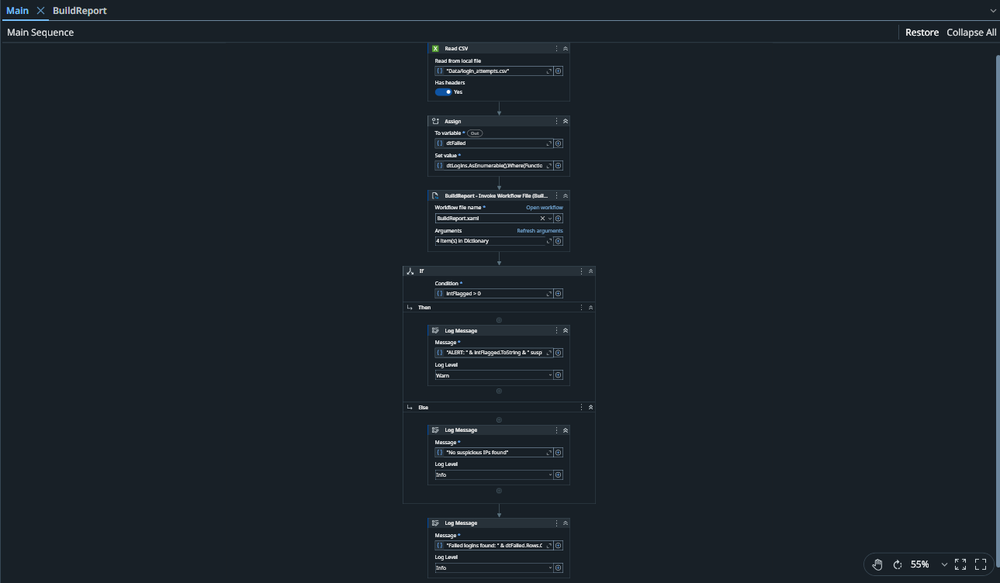
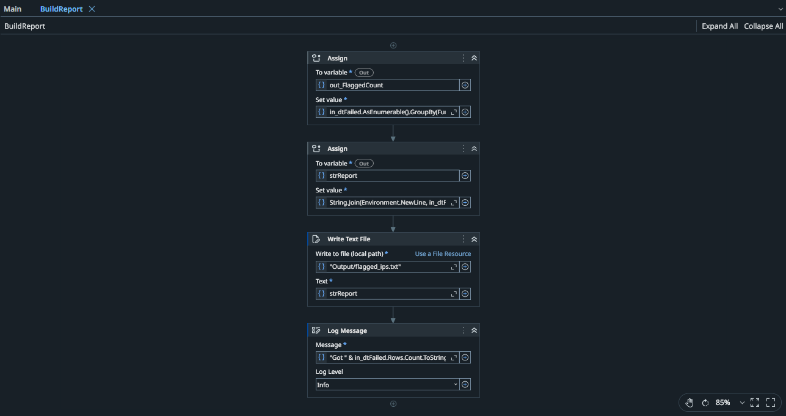

# Login Triage Bot (UiPath)

A small UiPath Studio automation that triages a CSV export of login attempts the way a security analyst would on a morning shift: it finds IP addresses with too many failed logins and flags the ones that **also managed to log in successfully** as *possibly compromised*.

Built as a lab assignment for *Strategic Business Process Automation* (Master's in Cybersecurity, Babeș-Bolyai University).

## The problem

Authentication logs are noisy. Normal users mistype passwords all the time, so a raw count of failures is not useful. What matters is:

1. Which source IPs fail **repeatedly** (brute force / password spraying)?
2. Did any of those IPs **eventually succeed**? That is the one that needs immediate attention.

Doing this by hand every morning is slow and easy to get wrong, so the bot does it in seconds and writes a ranked report.

## How it works

```
Main.xaml
 ├─ Read CSV                      -> dtLogins   (all login attempts)
 ├─ Assign                        -> dtFailed   (only rows where result = FAILED)
 ├─ Invoke Workflow File  ──────► BuildReport.xaml
 │                                  ├─ Assign  (count IPs at or over the threshold)
 │                                  ├─ Assign  (build the ranked report text)
 │                                  ├─ Write Text File -> Output/flagged_ips.txt
 │                                  └─ Log Message
 ├─ If intFlagged > 0
 │     ├─ Then: Log Message (Warn)  "ALERT: N suspicious IPs ..."
 │     └─ Else: Log Message (Info)  "No suspicious IPs found"
 └─ Log Message
```

### Arguments passed to `BuildReport.xaml`

| Argument | Direction | Type | Meaning |
|---|---|---|---|
| `in_dtFailed` | In | DataTable | Only the failed login attempts |
| `in_dtAll` | In | DataTable | All login attempts (used to look for successes) |
| `in_Threshold` | In | Int32 | Minimum failures per IP to be flagged (default 5) |
| `out_FlaggedCount` | Out | Int32 | How many IPs were flagged, returned to `Main` |

An IP is flagged when it has **at least `in_Threshold` failed attempts**. It is tagged `POSSIBLY COMPROMISED` when the same IP also has at least one `SUCCESS` in the data.

## Input and output

Input: `Data/login_attempts.csv` with columns `timestamp, username, source_ip, result`.

Output: `Output/flagged_ips.txt`, ranked by number of failures:

```
203.0.113.5: 47 failed attempts  <-- POSSIBLY COMPROMISED
198.51.100.23: 12 failed attempts
192.0.2.77: 6 failed attempts
```

### About the sample data

The data is entirely fake and generated by `tools/generate_sample_data.py` (fixed random seed, so it is reproducible). It contains 418 login attempts with four planted patterns:

| Source IP | Failures | What it simulates |
|---|---|---|
| `203.0.113.5` | 47 | Brute force on `admin` / `root`, followed by a **successful** login |
| `198.51.100.23` | 12 | Password spraying across many usernames |
| `192.0.2.77` | 6 | Borderline case, just over the threshold |
| `10.0.0.45` | 4 | Decoy, just under the threshold, must **not** be flagged |

The external IPs come from the ranges reserved for documentation (RFC 5737), so none of them belong to real hosts.

## How to run

1. Install [UiPath Studio](https://www.uipath.com/) (Community edition is enough).
2. Open `project.json` in Studio.
3. Open `Main.xaml` and press **Run** (not "Run file" from inside `BuildReport.xaml`, which would run it without the arguments).
4. Check the Output panel for the alert and `Output/flagged_ips.txt` for the report.

To change the sensitivity, edit the default value of the `intThreshold` variable in `Main`.

## Screenshots




## Limitations and ideas for improvement

- **No time ordering.** "Possibly compromised" only checks that a success exists for the IP, not that it came *after* the failures. A stricter version would compare timestamps.
- **No zero-failure guard.** If the input has no failed rows at all, `CopyToDataTable()` throws an error. A guard `If` before the filter would fix that.
- **Fixed IP-based logic.** It does not yet consider usernames, so password spraying from many IPs against one account would not be caught.
- The report is plain text. A CSV or an email notification would be natural next steps.

## Tech

UiPath Studio (VB, Windows project). Activities used include Read CSV, Assign, Invoke Workflow File, If, Write Text File and Log Message, with LINQ expressions for the grouping and filtering.

## Author

Arthur Vasinc
